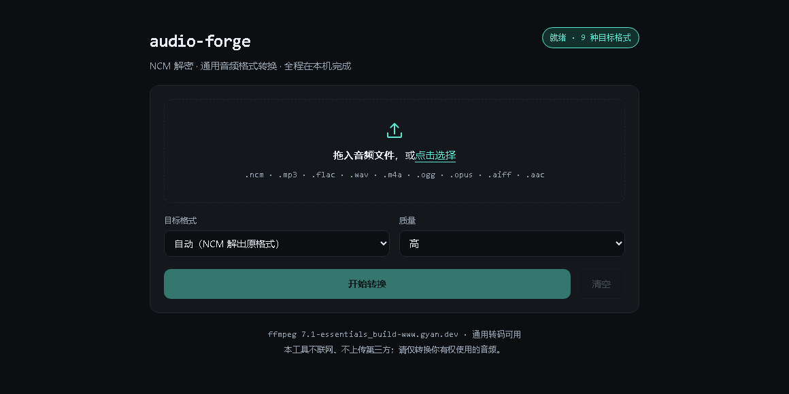

# audio-forge

**NCM 容器解密 + 通用音频格式转换，附一个零依赖的本地 Web 上传平台。**

纯 Python 实现，`pip install` 之后一条命令就能在浏览器里传文件、换格式、下载结果。
AES-128、RC4 变体 keystream、multipart 解析、HTTP 服务全部自己写，**没有任何第三方
Python 依赖**（`pip` 不会下载任何东西）。唯一的可选外部依赖是 ffmpeg，只服务于通用格式互转。

<p>


</p>



---

## 两个通道

| 通道 | 输入 | 输出 | 依赖 | 说明 |
| --- | --- | --- | --- | --- |
| **NCM 解密** | `.ncm` | 原始 `mp3` / `flac` | 无 | 剥离容器，逐字节还原码流；可顺带导出封面 |
| **通用转码** | 任意 ffmpeg 可读音频 | `mp3` `flac` `wav` `m4a` `aac` `ogg` `opus` `alac` `aiff` | ffmpeg | 有损格式支持 low/medium/high 三档或自定义码率 |

两个通道可以串联：`audioforge ncm song.ncm --to wav` 一步完成「解密 + 转码」。

---

## 快速开始

### 方式一：直接用源码（不需要安装）

```bash
git clone https://github.com/Garvin666/audio-forge.git
cd audio-forge
python -m audioforge serve          # 需要先设置 PYTHONPATH=src，或用下面的方式二
```

### 方式二：装成本地包（推荐）

```bash
git clone https://github.com/Garvin666/audio-forge.git
cd audio-forge
pip install .                       # 零第三方依赖，只装本项目
audioforge serve
```

打开 <http://127.0.0.1:8000> 即可看到上传页。

### 方式三：Docker（镜像里已带 ffmpeg）

```bash
docker build -t audio-forge .
docker run --rm -p 127.0.0.1:8000:8000 -v "$PWD/data:/data" audio-forge
```

或 `docker compose up -d`（`docker-compose.yml` 默认只绑回环地址）。

---

## Web 平台怎么用

1. **拖文件进去**，或点击选择。支持一次多个文件，`.ncm` 与常见音频可以混着传。
2. **选目标格式**：
   - `自动` —— `.ncm` 解出它本来就有的格式（mp3 还是 mp3、flac 还是 flac），其余文件必须指定格式；
   - 选具体格式 —— 所有文件统一转成该格式，`.ncm` 会自动走「先解密再转码」。
3. **选质量**：高 / 中 / 低。有损格式对应 320k / 192k / 128k（opus 更低），无损格式忽略此项。
4. 点 **开始转换**。上传有进度条，转换期间按钮变灰。
5. 结果列表出现后点 **下载**。链接在服务器保留 60 分钟（`--ttl` 可调），过后自动清理。

页面右上角的徽章会显示后端能力：拿到 ffmpeg 就是「就绪 · 9 种目标格式」，
拿不到就变成「仅 NCM 通道」，此时通用格式下拉被禁用，但 `.ncm` 照样能解。

---

## 命令行

```bash
# 解 .ncm（输出到源文件同目录）
audioforge ncm song.ncm

# 批量解整个目录（含子目录），同时导出内嵌封面
audioforge ncm ~/Music/ncm/ -r --cover -o ~/Music/out

# 解完直接转成 wav
audioforge ncm song.ncm --to wav

# 通用互转：flac -> mp3 320k
audioforge convert album/*.flac -f mp3 --quality high -o out/

# 自定义码率
audioforge convert a.wav -f opus --bitrate 96k

# 只看 .ncm 头部信息，不解音频
audioforge probe song.ncm --json

# 列出支持的格式与编码参数
audioforge formats

# 起 Web 平台（改端口 / 改上限 / 只写日志外）
audioforge serve --port 9000 --max-mb 500 --ttl 7200
```

`--ffmpeg /path/to/ffmpeg` 可显式指定 ffmpeg；也支持环境变量
`AUDIOFORGE_FFMPEG`、`FFMPEG_BIN`、`FFMPEG_PATH`。

**退出码**：`0` 全部成功，`1` 有文件失败，`2` 没有找到输入文件。

---

## HTTP API

Web 页面就是这套接口的客户端，可以单独调用。

### `GET /api/health`

```json
{
  "ok": true,
  "version": "1.0.0",
  "ffmpeg": "ffmpeg version 7.1-essentials_build ...",
  "capabilities": { "ncm": true, "transcode": true },
  "formats": ["aac", "aiff", "alac", "flac", "m4a", "mp3", "ogg", "opus", "wav"],
  "limits": { "max_upload_mb": 200, "job_ttl_minutes": 60 }
}
```

`ffmpeg` 为 `null` 表示只支持 NCM 通道。

### `POST /api/convert`

`multipart/form-data`，字段：

| 字段 | 必填 | 说明 |
| --- | --- | --- |
| `files` | 是 | 文件，可重复多次；`.ncm` 与普通音频可混传 |
| `target` | 是 | 目标格式，或 `auto`（仅对 `.ncm` 有效） |
| `quality` | 否 | `low` / `medium` / `high`，默认 `high` |
| `bitrate` | 否 | 覆盖码率，如 `320k` |

```bash
curl -F "files=@song.ncm" -F "target=wav" -F "quality=medium" \
     http://127.0.0.1:8000/api/convert
```

响应（单文件失败不会让整个请求失败，逐条给状态）：

```json
{
  "ok": true,
  "job": "60bcaaffd5804b22980272910cc7542c",
  "results": [
    {
      "ok": true,
      "source": "song.ncm",
      "name": "song.wav",
      "size": 47222916,
      "note": "NCM 解密（mp3，码率 320000） → wav",
      "url": "/api/file/60bcaaffd5804b22980272910cc7542c/song.wav",
      "meta": {
        "title": "我知道", "artists": ["By2"], "album": "Twins",
        "bitrate": 320000, "duration_s": 245.95, "has_cover": true
      }
    }
  ]
}
```

### `GET /api/file/<job>/<文件名>`

下载结果，带 `Content-Disposition: attachment`（中文名用 RFC 5987 编码）。
文件名做了白名单校验，越界路径直接 404。

### 错误码

| 状态 | 场景 |
| --- | --- |
| 400 | 缺 `Content-Length`、boundary 不合法、没有文件、字段超长 |
| 404 | 未知路由、job 不存在或已过期、路径越界 |
| 413 | 请求体超过 `--max-mb` |
| 500 | 服务端异常（响应里带异常类型与消息） |

---

## 项目结构

```
audio-forge/
├── src/audioforge/
│   ├── __init__.py          版本号与包说明
│   ├── __main__.py          python -m audioforge 入口
│   ├── aes.py               纯 Python AES-128-ECB 加解密 + PKCS#7
│   ├── ncm.py               NCM 容器解析、keystream 生成、流式解密
│   ├── transcode.py         ffmpeg 探测与转码参数翻译
│   ├── multipart.py         零依赖 multipart/form-data 解析（mmap 切片）
│   ├── server.py            标准库 HTTP 服务：上传、转换、下载、过期清理
│   ├── cli.py               子命令：ncm / convert / probe / formats / serve
│   └── web/                 前端（原生 HTML/CSS/JS，无构建、无 CDN）
│       ├── index.html
│       ├── app.js
│       └── style.css
├── tests/
│   ├── test_aes.py          FIPS-197 官方向量、补位边界
│   ├── test_ncm.py          现造 NCM fixture、跨分块边界、两种 key 布局
│   ├── test_multipart.py    字段/文件/中文名/路径穿越/超大字段
│   ├── test_transcode.py    wav→flac/mp3/opus/m4a（无 ffmpeg 时跳过）
│   └── test_server.py       端到端 HTTP：上传、下载、404、413
├── docs/
│   ├── FORMAT.md            NCM 容器格式逐字节说明 + 三十行参考实现
│   └── DEPLOY.md            Docker / 反代 / 公网部署清单
├── .github/workflows/ci.yml Python 3.9–3.13 矩阵测试
├── Dockerfile
├── docker-compose.yml
├── pyproject.toml
├── requirements.txt         故意留空：运行时零依赖，文件里写了原因
├── LICENSE
└── README.md
```

运行时会额外产生两类目录：`src/audioforge/web/` 是随包发布的静态资源；
转换结果放在系统临时目录的 `audioforge/jobs/<job>/`（Docker 里是 `/data`）。

---

## 依赖说明

### Python 侧

**零第三方依赖。** `pyproject.toml` 的 `dependencies = []`，`requirements.txt` 只有注释。

| 功能 | 实现方式 | 为什么不用第三方库 |
| --- | --- | --- |
| AES-128-ECB | `src/audioforge/aes.py`，S-box 由 GF(2⁸) 逆元 + 仿射变换生成 | 只解几百字节的小块，引入 pycryptodome 反而增加安装门槛 |
| PKCS#7 | 同上，另加宽松模式兼容非标准补位 | |
| keystream | `ncm.py`，RC4 KSA + 预展开周期表 | 这就是格式本身，没有现成库 |
| HTTP 服务 | 标准库 `http.server.ThreadingHTTPServer` | 一个本地工具不需要 Flask/FastAPI |
| multipart | `multipart.py`，`mmap` + `find` 切片 | Python 3.13 已移除 `cgi`，不能依赖它 |
| 前端 | 原生 HTML/CSS/JS | 不引 CDN、不需要 node 构建 |

最低 Python 版本 **3.9**（CI 覆盖 3.9 / 3.10 / 3.11 / 3.12 / 3.13）。

### 外部程序

| 程序 | 是否必需 | 用途 | 装法 |
| --- | --- | --- | --- |
| `ffmpeg` | 仅通用转码需要 | 解码/编码各类音频 | Windows `winget install Gyan.FFmpeg`；macOS `brew install ffmpeg`；Debian `apt install ffmpeg`；Docker 镜像已内置 |

探测顺序：环境变量（`AUDIOFORGE_FFMPEG` → `FFMPEG_BIN` → `FFMPEG_PATH`）→ `PATH`
→ Windows 常见安装目录 → `imageio_ffmpeg` 自带的静态二进制。

**没有 ffmpeg 会怎样**：NCM 通道完全正常，`/api/health` 返回 `transcode: false`，
前端把格式下拉禁用，CLI 的 `convert` 子命令与 `--to` 参数报错提示装 ffmpeg。
不会出现「静默降级成半成品文件」。

---

## 支持的格式

| 目标 | 扩展名 | 编码器 | 类型 | low / medium / high |
| --- | --- | --- | --- | --- |
| `mp3` | `.mp3` | libmp3lame | 有损 | 128k / 192k / 320k |
| `m4a` | `.m4a` | aac | 有损 | 96k / 160k / 256k |
| `aac` | `.aac` | aac（ADTS） | 有损 | 96k / 160k / 256k |
| `ogg` | `.ogg` | libvorbis | 有损 | 112k / 160k / 224k |
| `opus` | `.opus` | libopus | 有损 | 64k / 96k / 160k |
| `flac` | `.flac` | flac | 无损 | — |
| `alac` | `.m4a` | alac | 无损 | — |
| `wav` | `.wav` | pcm_s16le | 无压缩 | — |
| `aiff` | `.aiff` | pcm_s16be | 无压缩 | — |

输入侧不限：任何 ffmpeg 能解的都行（`.ncm` 额外走解密通道）。转码时保留原文件的
元数据（`-map_metadata 0`），并丢弃视频流（`-vn`）。

---

## 实现要点

### AES 是自己写的，而且对过官方测试向量

`aes.py` 里没有硬编码 S-box —— 用 GF(2⁸) 的 exp/log 表求逆元，再做仿射变换现场生成。
正确性由 FIPS-197 附录 B 与 C.1 的加解密向量兜住（`tests/test_aes.py`）。

这里有个真实的坑：`META_KEY` 的末尾是 `` `<` ``、`'`、`(`（hex `3C 27 28`），
很多现成脚本的注释把它写成 `` `<` ``、`(`、`'` —— 照抄注释，解出来的 JSON 就是一堆乱码。
**一切以 hex 为准。**

### 音频解密快了 53 倍

NCM 的音频段用 256 字节周期的 keystream 异或。逐字节 Python 循环解 9.4 MB 要 1.75 秒
（5.4 MB/s）；改成「预展开周期表 + 4 MiB 分块大整数异或」后是 0.033 秒（**287 MB/s**）。

分块大小必须是 256 的整数倍，否则第二块起相位错位、后半段全是噪音。代码里一旦出现
短读就直接抛错，不允许带着错的相位继续写文件。

### 上传不占内存

请求体先按 64 KiB 分块落到临时文件，再用 `mmap` 定位 boundary，文件 part 按区间流式
拷贝到目标路径。200 MB 的上传，进程内存不会跟着涨到 200 MB。

### 格式判定不看元数据、看码流

`meta` 里的 `format` 字段会缺、会错。真正决定输出扩展名的是**解密后**音频段的前 4 KB ——
`fLaC` 是 flac、`ID3`/`0xFFFB` 是 mp3。注意判断必须在解密之后做，因为 NCM 的音频段
连魔术字节一起被异或掉了。

---

## 测试

```bash
python -m unittest discover -s tests -t . -v
```

72 个用例，全部用标准库 `unittest`，不需要安装 pytest：

- **AES**：FIPS-197 两组官方向量、加解密往返、S-box 单射性、PKCS#7 边界与宽松模式
- **NCM**：测试用的 `.ncm` 不是样本文件，而是按 `docs/FORMAT.md` 现场造出来的 ——
  用 `AES128ECB.encrypt` 生成 key/meta 块，用同一张 keystream 表异或回去。
  覆盖 4 MiB 分块边界、非 256 对齐的尾块、新旧两种 key 布局、封面长度重复/单写、
  截断文件、非 NCM 输入
- **multipart**：中文字段、128 KiB 二进制保真、`../../evil.mp3` 清洗、重复文件名、超大字段
- **HTTP**：随机端口起真实服务，跑通上传→转换→下载全链路，另测 400/404/413 与路径穿越

CI 在 Python 3.9–3.13 五个版本上跑同一套测试。ffmpeg 相关用例在检测不到 ffmpeg 时自动跳过。
runner 若没预装 ffmpeg，CI 会装 `imageio-ffmpeg` 的静态二进制（不走 apt，避免多 job 抢锁）。

---

## 部署

本机自用（推荐）：

```bash
pip install .
audioforge serve                     # 127.0.0.1:8000，只有本机能访问
```

Docker：见 `Dockerfile` / `docker-compose.yml`，镜像里装了 ffmpeg，结果挂载到 `/data`。

公网部署（Nginx 反代、HTTPS、上传大小、并发与清理策略、需要自己补的鉴权）见
**[docs/DEPLOY.md](docs/DEPLOY.md)**。

---

## 安全边界与合规

**默认只监听 `127.0.0.1`。** 服务没有任何鉴权，任何能访问端口的人都能上传文件并读回
转换结果，所以：

- 不要直接把它暴露到公网。真要对外，请放在带鉴权的反向代理后面，或自己在网关层加 IP 白名单。
- 容器内必须 `--host 0.0.0.0` 才能被端口映射访问，这是唯一需要放开的场景。
- 单次请求上限默认 200 MB（`--max-mb`），结果默认保留 1 小时（`--ttl`），过期整目录清理。
- 上传文件名会剥掉目录部分、控制字符和 `<>:"/\|?*`，落盘路径再做一次 `resolve()` 校验。

**关于 NCM 与版权**：`.ncm` 是网易云音乐的客户端加密容器，解密能力只应作用于
**你自己合法拥有、且平台条款允许离线使用**的音频。本项目：

- 只做容器剥离与格式转换，不联网、不上传任何文件到第三方、不包含任何内容分发功能；
- 仓库不附带任何音频样本，测试 fixture 全部现场生成；
- 请勿用它批量下载、分发或二次销售受版权保护的音乐；由此产生的责任由使用者自负。

---

## 常见问题

**Q：`/api/health` 里 `transcode` 是 false？**
没找到 ffmpeg。装好后重启，或 `audioforge serve --ffmpeg /绝对路径/ffmpeg`。
Windows 上如果 ffmpeg 装在非 PATH 目录，用环境变量 `AUDIOFORGE_FFMPEG` 指过去最省事。

**Q：解出来的文件能播放但元数据（歌名/歌手）没了？**
NCM 把元数据放在单独的加密块里，本工具只还原音频码流，不往 mp3 的 ID3 头里回写标签。
需要标签请用 `mutagen` 之类的工具后处理，或用 `probe` 先看清原文件里的信息。

**Q：转码后体积变大了？**
转成 `wav`/`aiff` 是未压缩的，体积必然膨胀（320k mp3 约 2–4 倍）。
要小就用 `flac`（无损压缩）或 `opus`（低码率最划算）。

**Q：几十个文件一起传会不会超时？**
服务端是线程池（默认 4 并发），大文件转码本身耗 CPU。Linux/macOS 上建议把 `--max-mb`
按需调大，并把 `--ttl` 留足下载时间。

**Q：为什么不用 Flask / FastAPI？**
这个工具的使用场景是「本机跑一下」，标准库足够，装上就能跑、不会因为依赖版本冲突坏掉。
真要做成多人服务，建议重写那一层，而不是把 `http.server` 硬撑大。

---

## License

MIT。NCM 相关常量与格式结论来自对公开样本的实测分析，仅供互操作与研究使用。
